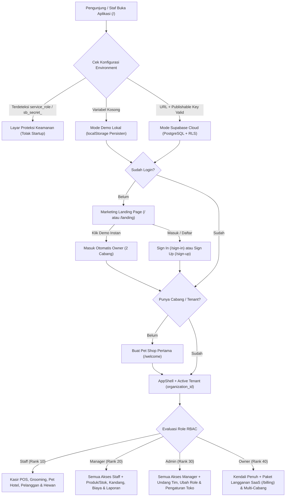
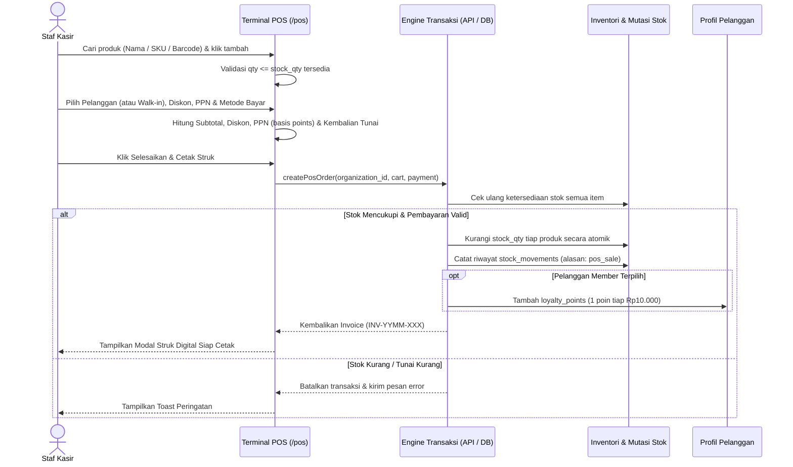
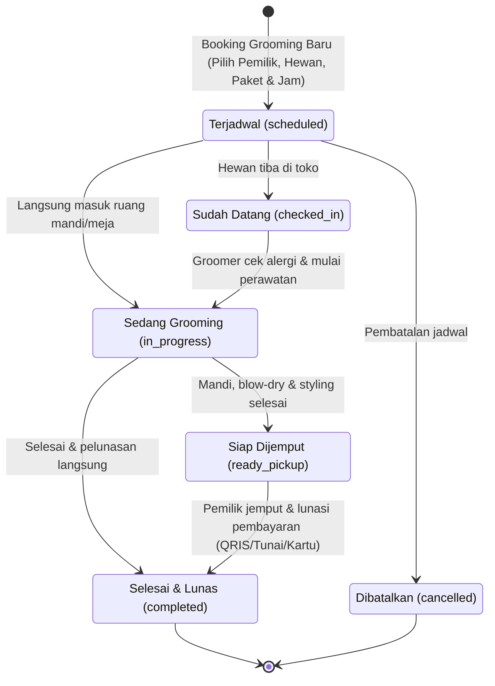
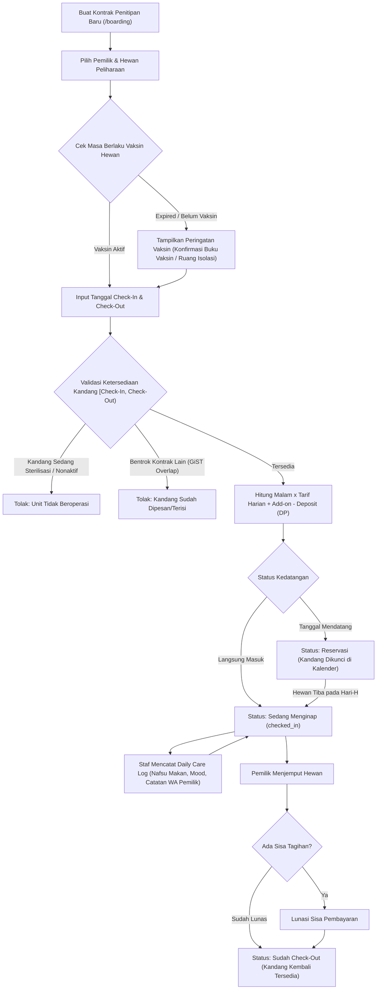
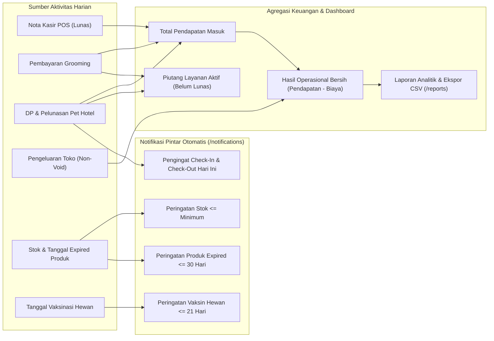
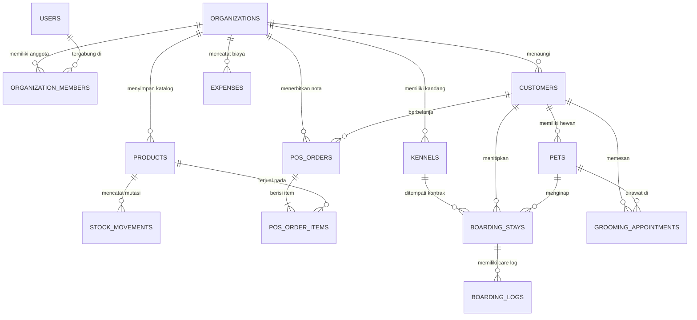

# Diagram Alur Sistem — Pawra Pet Shop SaaS

Dokumen ini memetakan alur kerja bisnis dan arsitektur teknis pada aplikasi **Pawra Pet Shop, Grooming & Pet Hotel SaaS**.

---

## 1. Alur Arsitektur Multi-Tenant, Autentikasi & Hak Akses (RBAC)

---

## 2. Alur Transaksi Kasir (POS) & Pemotongan Stok Atomik

---

## 3. Siklus Status Layanan & Antrean Grooming

---

## 4. Alur Kontrak Pet Hotel (Penitipan) & Proteksi Anti-Bentrok Kandang

---

## 5. Alur Konsolidasi Keuangan & Engine Notifikasi Pintar

---

## 6. Entity-Relationship Diagram (ERD) Skema Database Multi-Tenant

